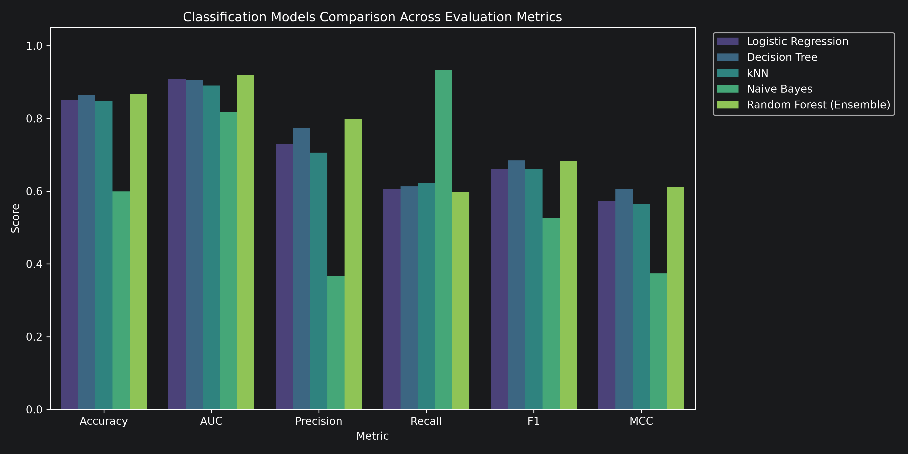

# Machine Learning Classification Assignment — Adult Census Income Prediction

## 1. Problem Statement
The objective of this project is to build, evaluate, and compare five supervised machine learning classification models to predict whether an individual's annual income exceeds **$50,000 (`>50K`)** or is **$50,000 or less (`<=50K`)** based on demographic, educational, and employment attributes from census records.

---

## 2. Dataset Description
* **Dataset Source:** Adult Census Income Dataset from the UCI Machine Learning Repository (`adult.data` and `adult.test`), extracted from the 1994 US Census database.
* **Why This Dataset Was Selected:** It contains a rich mix of continuous and categorical variables, natural missing values requiring imputation, and a realistic class imbalance—making it well-suited for evaluating classification trade-offs beyond simple accuracy.
* **Dataset Size & Features:**
  * **Total Instances:** 48,842 raw records (reduced after removing exact duplicate rows).
  * **Input Features:** 14 features (exceeding the minimum requirement of 12 features and 1,000 instances).
  * **Numerical Features (6):** `age`, `fnlwgt`, `education-num`, `capital-gain`, `capital-loss`, `hours-per-week`.
  * **Categorical Features (8):** `workclass`, `education`, `marital-status`, `occupation`, `relationship`, `race`, `sex`, `native-country`.
* **Target Variable:** `income` — Binary classification (`0` for `<=50K`, `1` for `>50K`).
* **Missing Values & Preprocessing:** Missing values were encoded as `"?"` in `workclass`, `occupation`, and `native-country`. All preprocessing steps—median imputation and `StandardScaler` for numerical columns, and most-frequent imputation with `OneHotEncoder` for categorical columns—were fitted strictly on the **80% stratified training split** (`random_state=42`) to prevent data leakage, and evaluated against the held-out 20% `test_data.csv`.
* **Class Distribution:** Imbalanced binary distribution with approximately **76% `<=50K`** (majority class) and **24% `>50K`** (minority class).

---

## 3. GitHub Repository Link
* **Repository Contents:**
  * `requirements.txt` — Python dependencies required to reproduce the environment.
  * `README.md` — Complete documentation, metrics comparison, visual chart, and model observations.
  * `test_data.csv` — Stratified 20% test split used to evaluate all models.
  * `model/` — Contains the complete Jupyter Notebook (`classification_models.ipynb`) implementing preprocessing, training, and evaluation.

---

## 4. Models Used & Evaluation Metrics Comparison

All five classification models were trained on the same preprocessed training set and evaluated on `test_data.csv`:

| ML Model Name | Accuracy | AUC | Precision | Recall | F1 | MCC |
| :--- | :---: | :---: | :---: | :---: | :---: | :---: |
| **Logistic Regression** | 0.8520 | 0.9081 | 0.7304 | 0.6053 | 0.6620 | 0.5724 |
| **Decision Tree** | 0.8647 | 0.9048 | 0.7746 | 0.6134 | 0.6847 | 0.6066 |
| **kNN** | 0.8473 | 0.8908 | 0.7057 | 0.6211 | 0.6607 | 0.5647 |
| **Naive Bayes** | 0.5990 | 0.8174 | 0.3672 | 0.9336 | 0.5271 | 0.3736 |
| **Random Forest (Ensemble)** | 0.8676 | 0.9201 | 0.7983 | 0.5980 | 0.6838 | 0.6123 |

### Metrics Visualization

---

## 5. Observations on Model Performance

| ML Model Name | Observation about model performance |
| :--- | :--- |
| **Logistic Regression** | Serves as a strong, well-calibrated linear baseline with a high AUC (`0.9081`) and solid accuracy (`0.8520`). Because it assumes linear decision boundaries across features, it trails tree-based models slightly on F1 (`0.6620`) and MCC (`0.5724`), missing non-linear interactions such as `capital-gain` thresholds combined with `education-num` and `marital-status`. |
| **Decision Tree** | Captures non-linear splits effectively, achieving the highest F1 score (`0.6847`) and second-highest accuracy (`0.8647`) and MCC (`0.6066`). Constraining tree depth (`max_depth=10`) prevented severe overfitting while balancing precision (`0.7746`) and recall (`0.6134`) on the minority `>50K` class. |
| **kNN** | Delivers competitive recall (`0.6211`, second-highest overall) and respectable accuracy (`0.8473`), but suffers from lower precision (`0.7057`) and MCC (`0.5647`). High dimensionality created by one-hot encoding categorical features dilutes Euclidean distance calculations, reducing separation power compared to tree ensembles. |
| **Naive Bayes** | Exhibits an extreme precision-recall trade-off: it achieves the highest recall (`0.9336`)—catching almost all `>50K` earners—but at the cost of very low precision (`0.3672`), overall accuracy (`0.5990`), and MCC (`0.3736`). Gaussian Naive Bayes assumes feature independence and normal distributions, which is violated by heavily skewed features (`capital-gain`, `capital-loss`) and sparse one-hot encoded indicators, causing over-prediction of the positive class. |
| **Random Forest (Ensemble)** | Delivers the strongest overall generalization across the dataset, leading in **Accuracy (`0.8676`)**, **AUC (`0.9201`)**, **Precision (`0.7983`)**, and **MCC (`0.6123`)**. By aggregating multiple decision trees, it reduces variance and handles mixed numerical/categorical interactions far better than single linear or distance-based classifiers. |
| **Overall Winner for your dataset?** | **Random Forest (Ensemble)** is the clear overall winner. Because the Adult Census dataset has a ~76:24 class imbalance, **MCC (`0.6123`)** and **AUC (`0.9201`)** are the most reliable indicators of true classification quality—and Random Forest ranks #1 on both while maintaining the highest accuracy (`0.8676`) and precision (`0.7983`). |
